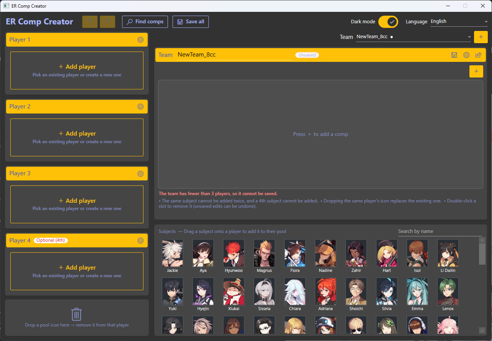

# ER Comp Simulator

A tool for planning team compositions ("comps") for Eternal Return.

> ⚠️ This is a beta version. You may run into bugs or parts that don't work properly.

[日本語](./README.md) / [English](./README-en.md) / [한국어](./README-ko.md) / [繁體中文](./README-zh-TW.md)

## What you can do

- Register players and manage which characters (subjects) they play
- Register teams (multiple teams are supported)
- Build comps for each team, with an optional RouteID and weapon for each character
- Export / import team and player data
- Look up saved comps by character (Find comps)
- Dark mode (toggle at the top of the screen)
- Use the app in Japanese, English, Korean, or Traditional Chinese (searching characters works with names in any language)

## Getting started

For Windows 11 (64-bit). **You do not need to install .NET separately** — the app is a single exe that includes everything it needs. Just download and run it.

1. On first launch, a **language selection screen** appears. Choose your language (you can change it later inside the app).
2. A team with a placeholder name is created for you.
3. Your data is stored next to the app (exe): `ertool.db` (data) and `settings.json` (language and other settings).
  - Beta-007 adds weapon data to `ertool.db` (it is updated automatically on launch, and your existing data is kept). If you might go back to Beta-006 or earlier, back up `ertool.db` before updating.

Sample data is available in the [`Sample/2026-KEL`](./Sample/2026-KEL) folder of this repository.

The screen is laid out as: **Player area** on the left, the **character list** at the bottom center, and the **Team area** on the right.

---

## Registering players

- Press "Add player" to register a player name and a Dak.gg player name.
  - For Dak.gg, enter **only the [player name] part** of `https://dak.gg/er/players/[player name]` (the app builds the URL when it opens it).
  - Pasting the full URL also works. It is converted to just the player name when you save.
  - The player name doesn't have to match the Dak.gg name. Use whatever name is easy to recognize.
  - Player names must be unique (case-insensitive).
- You can also add a player who is already registered in another team (players are shared across teams).

### Buttons in the Player area

| Button | What it does |
| --- | --- |
| 💾 Floppy disk | Saves the player data |
| ⚙ Gear | Player settings: delete data, import, etc. |
| 🌐 Globe | Opens Dak.gg in your browser (unavailable if no Dak.gg player name is registered) |
| ⤴ Share icon | Exports the player data (for sharing with others) |
| ✕ Cross | Removes this player from the team |

### Assigning characters to a player

- **Drag and drop a character image** from the list at the bottom center into the Player area.
- To remove one, drag it onto the trash bin below.
- Use the filter box to **search characters by name**. A match in any language works (for example, "Ay" finds Aya). Hiragana and katakana are treated the same, and several words separated by spaces must all match.

### Swapping players

- **Drag a Player header (the name bar) onto another Player slot** to move the player there.
- If another player is already in that slot, they are removed from the team, and their assignments are removed from the comps. Press **Ctrl+Z** to undo.
- Dropping onto an empty slot simply moves the player.

---

## Teams

### Controls on the right

- **Team name**: click the team name in the header to edit it directly (Enter to apply, Esc to cancel). Team names may be duplicated.
- **Team combo box**: switch between teams. Use "+" to add a new team.
- **💾 Floppy disk**: saves the team. **At least 3 players (already saved)** are required.
- **⚙ Gear**: team settings, such as deleting the team.
- **⤴ Share icon**: exports the team. The linked players are exported together. Use it to share with others.
- **"+" at the bottom**: adds a comp. Switch between comps with the tabs on the left.
    - When there are too many comps to fit, a horizontal scroll bar appears under the tabs. Drag it, or use the mouse wheel, to move left and right.

### Putting characters into a comp

- **Drag and drop characters** from the Player area into the comp.
    - Double-click to remove an assignment.
    - For the same player, drag another character to swap it in.
- The three slots of a comp are ordered by the **number of the Player on the left**.
- Even with the same set of characters, comps are **separate if the players are different**. Only a comp whose characters and players are exactly the same counts as a duplicate and cannot be saved (the order does not matter).
- If you remove a character from a player's pool, it also disappears from the comps.

### RouteID

- Each comp slot has a **RouteID** field (an integer of 1 or more) below the player name.
- It's optional, and the same number can be used in several slots.
- Press Enter or move focus away to apply it.

### Weapons

- When you put a character into a comp, a **weapon** square appears at the bottom right of the character image.
  - **Characters with only one weapon**: that weapon is shown automatically (it cannot be changed).
  - **Characters with two or more weapons**: it starts as an empty slot with a red ×. Click it to open a selection panel right there.
    - The × on the left means "no weapon". The available weapons follow in order.
    - Hover over a weapon to see its name in the current language.
    - Click a weapon to set it. Click outside the panel to cancel and close it.
- Choosing a weapon is optional. You can save without one.
- If you swap in a different character, the weapon is reset (placing the same character again keeps it). Removing a character from a comp also removes its weapon.
- Weapons are included when you save, export, and import teams. A player's pool of characters has nothing to do with weapons.
- **Weapons are not part of the duplicate check.** A comp with the same characters and the same players that differs only in weapons counts as the same comp (a duplicate) and cannot be saved.

#### Notes about weapons

- **Alex** is a character designed to have his equipment updated, so his weapon is fixed to Tonfa.
- **Echion** can only use the evolved weapons (Deathadder, BlackMamba, Sidewinder).

---

## Finding comps by character

Answer "which comps include this character?" across all your saved teams.

- The **"Find comps" button** at the top opens a separate window. You can keep using the main window while it is open.
- **Click characters** in the list on the left to select them (up to 3).
  - Use the box at the top to filter by name (any language works).
  - Selected characters are shown at the top right. Click one to unselect it, or use "Clear" to unselect all.
- Comps that **include all the selected characters** are listed on the right.
  - Each result shows the team name, the comp number, and the three players with their characters and RouteIDs. The selected characters are highlighted.
  - Results are sorted by team name, then by comp number.
- Only **saved data** is searched. Changes you are still editing in the main window (not saved yet) are not included.

---

## Saving and undo

- Changes are kept as a draft and are not written to the database until you save. While there are unsaved changes, **"● Unsaved"** is shown.
- **Ctrl+S**: saves the open team and players together (Save all).
- **Ctrl+Z**: undoes the last action (redo is also available).
- Players and teams can also be saved individually.
- After you save a team, the comp you were viewing stays selected.
- If the same data was changed elsewhere first, you'll be asked whether to overwrite it.

## Dark mode

- Use the **"Dark mode" switch** at the top right to switch the app to a dark color scheme.
- On first launch, the initial value follows your Windows "app mode" setting.
- Your choice is saved in `settings.json` and used on every later launch (changing the Windows setting afterwards does not affect it).

## Language

- Switch language any time with the language selector in the app. No restart is needed.
- The translations are based on machine translation, so there may be mistakes.

---

## (For advanced users) Avoiding the "untrusted publisher" warning

A public key is included. Register it in your list of trusted keys.
