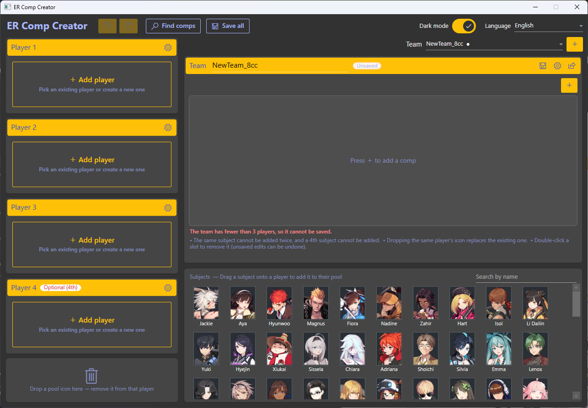

# ER Comp Simulator

Eternal Return의 팀 구성(컴프)을 짜기 위한 도구입니다.

> ⚠️ 베타 버전입니다. 버그가 있거나 제대로 동작하지 않는 부분이 있을 수 있습니다.

[日本語](./README.md) / [English](./README-en.md) / [한국어](./README-ko.md) / [繁體中文](./README-zh-TW.md)

## 할 수 있는 것

- 선수(플레이어) 등록과 사용하는 실험체 관리
- 팀 등록 (여러 팀 관리 지원)
- 팀별 구성(컴프) 작성. 실험체마다 RouteID도 등록할 수 있습니다
- 팀/선수 정보 내보내기 / 가져오기
- 실험체로 저장된 조합을 역으로 찾을 수 있습니다 (조합 검색)
- 다크 모드 지원 (화면 상단의 스위치로 전환)
- 일본어·영어·한국어·중국어(번체) 표시 (실험체 이름 검색도 어느 언어로든 가능)

## 시작하기

Windows 11(64비트)용입니다. **.NET을 따로 설치할 필요가 없습니다** (필요한 것을 모두 포함한 exe입니다). 다운로드해서 실행하기만 하면 됩니다.

1. 처음 실행하면 **언어 선택 화면**이 나옵니다. 사용할 언어를 고르세요 (나중에 앱 안에서 바꿀 수 있습니다).
2. 임시 이름이 붙은 팀이 하나 만들어져 있습니다.
3. 데이터는 앱(exe)과 같은 위치의 `ertool.db`(데이터)와 `settings.json`(언어 등 설정)에 저장됩니다.

샘플 데이터는 이 저장소의 [`Sample/2026-KEL`](./Sample/2026-KEL) 폴더에 있습니다.

화면은 왼쪽이 **Player(선수) 영역**, 가운데 아래가 **실험체 목록**, 오른쪽이 **Team(팀) 영역**입니다.

---

## 선수(Player) 등록

- "선수 추가"를 누르면 선수 이름과 Dak.gg 링크를 등록할 수 있습니다.
  - 선수 이름은 Dak.gg의 이름과 같지 않아도 됩니다. 알아보기 쉬운 이름을 붙이세요.
  - 선수 이름은 대소문자를 구분하지 않고 중복해서 등록할 수 없습니다.
- 이미 다른 팀에 등록한 선수를 그대로 추가할 수도 있습니다 (선수는 여러 팀에서 공유됩니다).

### Player 영역의 버튼

| 버튼 | 내용 |
| --- | --- |
| 💾 플로피 | 선수 데이터를 저장합니다 |
| ⚙ 톱니바퀴 | 선수 설정. 데이터 삭제, 가져오기 등 |
| 🌐 지구본 | 브라우저에서 Dak.gg를 엽니다 (Dak.gg를 등록하지 않은 선수는 사용 불가) |
| ⤴ 내보내기 | 선수 데이터를 내보냅니다 (다른 사람과 공유할 때) |
| ✕ 엑스 | 이 선수를 팀에서 제외합니다 |

### 선수에게 실험체 등록하기

- 가운데 아래의 **실험체 이미지를 Player 영역으로 드래그 앤 드롭**하여 추가합니다.
- 삭제할 때는 실험체를 아래의 휴지통으로 드래그 앤 드롭합니다.
- 필터 입력란에서 **이름으로 실험체를 검색**할 수 있습니다. 어느 언어의 이름이든 검색됩니다 (예: "Ay"로도 아야를 찾을 수 있음). 히라가나와 가타카나는 구분하지 않으며, 공백으로 나누면 모든 단어를 포함하는 것만 표시됩니다.

### 선수 교체하기

- **Player 영역의 머리글(이름 띠)을 다른 Player 칸으로 드래그**하면 선수가 그 칸으로 이동합니다.
- 그 칸에 있던 선수는 팀에서 제외되고, 그 선수의 담당은 구성에서 사라집니다. 실수했다면 **Ctrl+Z**로 되돌릴 수 있습니다.
- 빈 칸으로 드래그하면 단순히 이동합니다.

---

## 팀(Team)

### 오른쪽 조작

- **팀 이름**: 머리글의 팀 이름을 직접 클릭하여 수정할 수 있습니다 (Enter로 확정, Esc로 취소). 팀 이름은 중복되어도 됩니다.
- **Team 콤보박스**: 팀을 전환합니다. "+"로 새 팀을 추가할 수 있습니다.
- **💾 플로피**: 팀 데이터를 저장합니다. **선수가 3명 이상(저장된 상태)** 이어야 저장할 수 있습니다.
- **⚙ 톱니바퀴**: 팀 설정. 팀 정보 삭제 등.
- **⤴ 내보내기**: 팀 데이터를 내보냅니다. 연결된 선수 정보도 함께 내보내집니다. 다른 사람과 공유할 때 사용합니다.
- **아래의 "+"**: 구성을 추가합니다. 추가한 구성은 왼쪽 탭에서 전환합니다.
    - 조합이 많아 탭이 다 들어가지 않으면 탭 아래에 가로 스크롤 바가 나타납니다. 바를 드래그하거나 마우스 휠로 좌우로 움직일 수 있습니다.

### 구성(컴프)에 실험체 넣기

- Player 영역의 실험체를 **구성으로 드래그 앤 드롭**하여 추가합니다.
    - 더블 클릭하면 담당을 제외할 수 있습니다.
    - 같은 선수라면 다른 실험체를 드래그 앤 드롭하여 교체할 수 있습니다.
- 구성의 3개 슬롯은 **왼쪽 Player의 번호 순서**로 정렬됩니다.
- 같은 실험체 조합이라도 **담당 선수가 다르면 별개의 구성**으로 등록할 수 있습니다. 실험체와 담당 선수가 모두 완전히 같은 구성만 중복으로 간주되어 저장할 수 없습니다 (순서는 상관없습니다).
- 선수의 풀에서 실험체를 삭제하면 구성에서도 사라집니다.

### RouteID

- 구성의 각 슬롯에는 선수 이름 아래에 **RouteID**(1 이상의 정수)를 등록할 수 있습니다.
- 입력은 선택 사항이며, 같은 번호를 여러 슬롯에 써도 됩니다.
- Enter를 누르거나 포커스를 옮기면 확정됩니다.

---

## 실험체로 조합 찾기 (조합 검색)

"이 실험체가 들어간 조합은 무엇일까?"를 저장된 모든 팀에서 찾을 수 있습니다.

- 화면 상단의 **"조합 검색" 버튼**을 누르면 별도의 창이 열립니다. 메인 화면을 열어 둔 채로 사용할 수 있습니다.
- 왼쪽 실험체 목록에서 찾고 싶은 실험체를 **클릭하여 선택**합니다 (최대 3개).
  - 위의 입력란에서 이름으로 검색할 수 있습니다 (어느 언어의 이름이든 일치합니다).
  - 선택한 실험체는 오른쪽 위에 표시됩니다. 클릭하면 선택이 해제되고, "선택 해제"로 한꺼번에 해제할 수 있습니다.
- 선택한 실험체를 **모두 포함하는 조합**이 오른쪽에 목록으로 표시됩니다.
  - 팀 이름, 조합 번호, 3명의 선수·실험체·RouteID가 표시되며, 선택한 실험체 칸은 색으로 강조됩니다.
  - 정렬 순서는 팀 이름 → 조합 번호 순입니다.
- 검색 대상은 **저장된 데이터**입니다. 메인 화면에서 편집 중인(아직 저장하지 않은) 내용은 포함되지 않습니다.

---

## 저장과 되돌리기

- 변경 사항은 먼저 "초안"으로 취급되며, 저장하기 전에는 데이터베이스에 기록되지 않습니다. 저장하지 않은 변경이 있는 동안 **"● 미저장"** 이 표시됩니다.
- **Ctrl+S**: 현재 열려 있는 팀과 선수를 한꺼번에 저장합니다 (일괄 저장).
- **Ctrl+Z**: 직전 동작을 되돌립니다 (다시 실행도 가능합니다).
- 선수와 팀을 각각 따로 저장할 수도 있습니다.
- 팀을 저장한 뒤에도, 저장 전에 보고 있던 구성이 그대로 표시됩니다.
- 같은 데이터가 다른 곳에서 먼저 변경된 경우 덮어쓸지 확인하는 창이 나옵니다.

## 다크 모드

- 화면 오른쪽 위의 **"다크 모드" 스위치**로 화면 색상을 어두운 색으로 바꿀 수 있습니다.
- 처음 실행하면 Windows의 "앱 모드" 설정이 초깃값이 됩니다.
- 바꾼 내용은 `settings.json`에 저장되며, 다음 실행부터는 그 설정으로 표시됩니다 (이후 Windows 설정을 바꿔도 앱은 저장된 설정을 사용합니다).

## 언어

- 앱 안의 언어 선택으로 언제든 전환할 수 있습니다. 재시작은 필요 없습니다.
- 다국어 문구는 기계 번역을 바탕으로 하므로 오역이 있을 수 있습니다.

---

## (PC에 익숙한 분께) "신뢰할 수 없는 서명" 경고를 피하고 싶다면

공개 키를 함께 제공합니다. 이를 신뢰하는 키 목록에 등록해 주세요.
