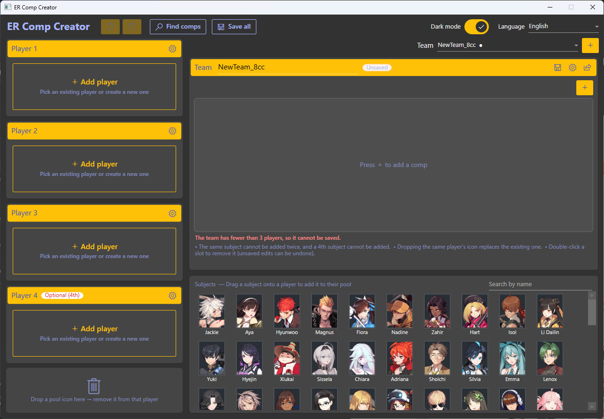

# ER Comp Simulator

用來規劃 Eternal Return 隊伍組合(陣容)的工具。

> ⚠️ 這是測試版。可能會有錯誤,或部分功能無法正常運作。

[日本語](./README.md) / [English](./README-en.md) / [한국어](./README-ko.md) / [繁體中文](./README-zh-TW.md)

## 功能

- 登錄選手(玩家),並管理其使用的實驗體
- 登錄隊伍(支援管理多個隊伍)
- 為各隊伍建立陣容,並可為每個實驗體登錄 RouteID
- 匯出 / 匯入隊伍與選手資料
- 可依實驗體反查已儲存的陣容(陣容搜尋)
- 支援深色模式(用畫面上方的開關切換)
- 支援日文、英文、韓文、繁體中文顯示(實驗體名稱也可用任一語言搜尋)

## 開始使用

適用於 Windows 11(64 位元)。**不需要另外安裝 .NET**(這是一個包含所需內容的 exe)。下載後直接執行即可使用。

1. 第一次啟動時會出現**語言選擇畫面**,請選擇要使用的語言(之後可在程式內更改)。
2. 程式會先建立一個使用暫定名稱的隊伍。
3. 資料會儲存在程式(exe)所在的資料夾:`ertool.db`(資料)與 `settings.json`(語言等設定)。

範例資料放在此儲存庫的 [`Sample/2026-KEL`](./Sample/2026-KEL) 資料夾中。

畫面左側是 **Player(選手)區**,中央下方是**實驗體清單**,右側是 **Team(隊伍)區**。

---

## 登錄選手(Player)

- 按下「新增選手」,即可登錄選手名稱與 Dak.gg 連結。
  - 選手名稱不必與 Dak.gg 的名稱相同,請取一個容易辨識的名稱。
  - 選手名稱不分大小寫,不能重複登錄。
- 也可以直接加入已在其他隊伍登錄過的選手(選手可在多個隊伍間共用)。

### Player 區的按鈕

| 按鈕 | 功能 |
| --- | --- |
| 💾 磁片 | 儲存選手資料 |
| ⚙ 齒輪 | 選手設定:刪除資料、匯入等 |
| 🌐 地球 | 在瀏覽器開啟 Dak.gg(未登錄 Dak.gg 的選手無法使用) |
| ⤴ 匯出圖示 | 匯出選手資料(與他人分享時使用) |
| ✕ 叉號 | 將此選手從隊伍中移除 |

### 為選手登錄實驗體

- 將中央下方的**實驗體圖片拖曳到 Player 區**即可新增。
- 要刪除時,將實驗體拖曳到下方的垃圾桶。
- 可在篩選欄中**依名稱搜尋實驗體**。任何語言的名稱都能符合(例如輸入「Ay」也能找到亞雅)。平假名與片假名視為相同,以空白分隔多個詞時,會找出同時包含所有詞的項目。

### 更換選手

- 將 **Player 區的標題列(名稱列)拖曳到另一個 Player 欄位**,選手就會移到該欄位。
- 原本在該欄位的選手會被移出隊伍,其負責的項目也會從陣容中消失。操作錯誤時可按 **Ctrl+Z** 復原。
- 拖曳到空的欄位時,只會單純移動。

---

## 隊伍(Team)

### 右側的操作

- **隊伍名稱**:可直接點擊標題中的隊伍名稱進行修改(按 Enter 確認,Esc 取消)。隊伍名稱可以重複。
- **Team 下拉選單**:切換隊伍。按「+」可新增隊伍。
- **💾 磁片**:儲存隊伍資料。需要有 **3 名以上(已儲存)的選手**才能儲存。
- **⚙ 齒輪**:隊伍設定,例如刪除隊伍資訊。
- **⤴ 匯出圖示**:匯出隊伍資料,相關聯的選手資訊也會一併匯出。與他人分享時使用。
- **下方的「+」**:新增陣容。新增的陣容可用左側的分頁切換。
    - 陣容太多、分頁放不下時,分頁下方會出現水平捲軸。可拖曳捲軸,或用滑鼠滾輪左右移動。

### 將實驗體放入陣容

- 將 Player 區的實驗體**拖曳到陣容**即可新增。
    - 按兩下可取消該項負責。
    - 同一位選手可拖曳其他實驗體來替換。
- 陣容的 3 個欄位會依**左側 Player 的編號順序**排列。
- 即使實驗體組合相同,**只要負責的選手不同,就是不同的陣容**,可分別登錄。只有實驗體與負責選手完全相同的陣容才視為重複而無法儲存(與順序無關)。
- 從選手的實驗體清單中刪除實驗體後,陣容中也會一併消失。

### RouteID

- 陣容的每個欄位,可在選手名稱下方登錄 **RouteID**(1 以上的整數)。
- 為選填,同一個編號可用於多個欄位。
- 按 Enter 或移開焦點即可確認。

---

## 依實驗體搜尋陣容(陣容搜尋)

可以從所有已儲存的隊伍中,找出「哪些陣容包含這個實驗體?」。

- 點擊畫面上方的**「陣容搜尋」按鈕**,會開啟另一個視窗。開著主畫面也能同時使用。
- 在左側的實驗體清單中,**點擊**想找的實驗體來選擇(最多 3 個)。
  - 可用上方的輸入欄依名稱篩選(任何語言的名稱都能符合)。
  - 選擇的實驗體會顯示在右上方。點擊即可取消選擇,按「清除選擇」可一次全部取消。
- 右側會列出**包含所有所選實驗體的陣容**。
  - 會顯示隊伍名稱、陣容編號,以及 3 位選手、實驗體與 RouteID。所選實驗體的欄位會以顏色強調。
  - 排序依隊伍名稱、陣容編號的順序。
- 搜尋對象是**已儲存的資料**。在主畫面編輯中(尚未儲存)的內容不包含在內。

---

## 儲存與復原

- 變更會先視為「草稿」,儲存前不會寫入資料庫。有未儲存的變更時,會顯示 **「● 未儲存」**。
- **Ctrl+S**:一併儲存目前開啟的隊伍與選手(全部儲存)。
- **Ctrl+Z**:復原上一個操作(也可以重做)。
- 選手與隊伍也可以分別單獨儲存。
- 儲存隊伍後,儲存前正在查看的陣容會維持顯示。
- 若相同資料已在其他地方先被更改,會顯示是否要覆寫的確認視窗。

## 深色模式

- 用畫面右上角的**「深色模式」開關**,可將畫面切換為深色配色。
- 第一次啟動時,初始值會依 Windows 的「應用程式模式」設定。
- 切換的內容會儲存在 `settings.json`,之後啟動時會依此設定顯示(之後更改 Windows 設定,程式仍使用已儲存的設定)。

## 語言

- 可隨時用程式內的語言選單切換,無需重新啟動。
- 多語言文字是以機器翻譯為基礎,可能有誤譯。

---

## (給熟悉電腦的使用者)想避免「不受信任的簽章」警告

隨附了公開金鑰,請將它登錄到信任的金鑰清單中。
