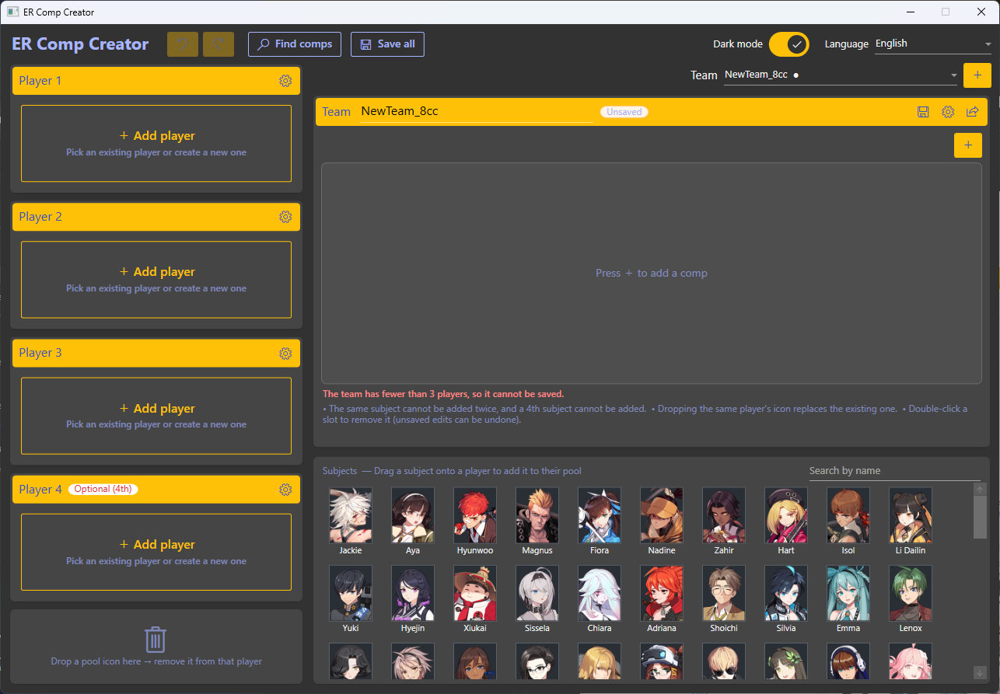

# ER Comp Simulator

Eternal Return のチーム構成(コンプ)を考えるためのツールです。

> ⚠️ ベータ版です。不具合や、うまく動かない部分があるかもしれません。
> Releaseからダウンロードが可能です

[日本語](./README.md) / [English](./README-en.md) / [한국어](./README-ko.md) / [繁體中文](./README-zh-TW.md)

## できること

- 選手(プレイヤー)の登録と、使える実験体の管理
- チームの登録(複数チームの管理に対応)
- チームごとの構成(コンプ)の作成。
  - 実験体ごとに RouteID も登録できます
  - 実験体ごとに使う武器も選べます
- チーム情報・選手情報のエクスポート / インポート
  - 他メンバーやチーム等と情報共有ができます
- 実験体から、保存済みの構成を逆引きできます(構成検索)
- ダークモード対応(画面上部のスイッチで切り替え)
- 日本語・英語・韓国語・台湾語の表示(実験体名の検索も、どの言語でも可能)

## はじめに

Windows 11(64bit)向けです。**.NET を別にインストールする必要はありません**(必要なものを含めた exe です)。ダウンロードして実行するだけで使えます。

1. 初めて起動すると、**言語の選択画面**が出ます。使いたい言語を選んでください(あとから画面内で変えられます)。
2. 最初から、名前が仮に付いたチームが1つ作成されています。
3. データは、アプリ(exe)と同じ場所の `ertool.db`(データ)と `settings.json`(言語などの設定)に保存されます。
  - このファイルをアップデート後に差し替えることで旧データを新バージョンへ移行が可能です。変更が必要な場合はリリースノートに記載されます。
  - Beta-007 で、`ertool.db` に武器の情報が加わります(起動時に自動で更新され、既存のデータはそのまま引き継がれます)。Beta-006 以前へ戻す可能性がある場合は、更新前に `ertool.db` のバックアップを取ってください。

サンプルデータは、このリポジトリの [`Sample/2026-KEL`](./Sample/2026-KEL) フォルダにあります。

画面は、左が **Player(選手)欄**、中央下が **実験体リスト**、右が **Team(チーム)欄**です。

---

## 選手(Player)の登録

- 「選手を追加」を押すと、選手名と Dak.gg のプレイヤー名を登録できます。
  - Dak.gg には、`https://dak.gg/er/players/[プレイヤー名]` の **[プレイヤー名] の部分だけ**を入力します(アプリが URL を組み立てて開きます)。
  - フルの URL を貼り付けても大丈夫です。保存するときに、プレイヤー名だけに変換されます。
  - 選手名は Dak.gg の名前と同じでなくて構いません。わかりやすい名前をつけてください。
  - 選手名は、大文字・小文字を区別せず、同じ名前を重ねて登録することはできません。
- すでに他のチームに登録した選手を、そのまま追加することもできます(選手は複数のチームで共有されます)。

### Player 欄のボタン

| ボタン | 内容 |
| --- | --- |
| 💾 フロッピー | 選手データを保存します |
| ⚙ 歯車 | 選手の設定。データの消去・インポートなど |
| 🌐 地球儀 | ブラウザで Dak.gg を開きます(Dak.gg のプレイヤー名を登録していない選手では使えません) |
| ⤴ 外出しマーク | 選手データをエクスポートします(他の人と共有するときに) |
| ✕ バツ | このプレイヤーをチームから外します |

### 実験体を選手に登録する

- 中央下の**実験体画像を、Player 欄へドラッグアンドドロップ**して追加します。
- 消すときは、実験体を下のごみ箱へドラッグアンドドロップします。
- 上の入力欄で、実験体を**名前で絞り込めます**。どの言語の名前でも該当します(例:「アヤ」のかわりに「Ay」でも OK。ひらがな・カタカナの違いは区別されません。スペースで区切ると、すべてを含むものに絞れます)。

### 選手を入れ替える

- **Player 欄の見出し(名前の帯)を、別の Player 枠へドラッグ**すると、選手がそこへ移動します。
- 移動先にいた選手はチームから外れ、その選手の担当は構成から消えます。間違えたときは **Ctrl+Z** で戻せます。
- 空いている枠へドラッグした場合は、単なる移動となります。

---

## チーム(Team)

### 右側の操作

- **チーム名**: 見出しのチーム名を、直接クリックして書き換えられます(Enter で確定、Esc で取り消し)。チーム名は、同じ名前を付けても構いません。
- **Team のコンボボックス**: チームを切り替えます。「＋」で新しいチームを追加できます。
- **💾 フロッピー**: チームデータを保存します。**選手が3人以上(保存済み)** いないと保存できません。
- **⚙ 歯車**: チームの設定。チーム情報の消去など。
- **⤴ 外出しマーク**: チームデータをエクスポートします。結びついている選手の情報も一緒に書き出されます。他の人と共有するときに使います。
- **下の「＋」**: 構成を追加します。追加した構成は、左のタブで切り替えます。
    - 構成が増えてタブが収まらなくなると、タブの下に横スクロールのバーが出ます。バーのドラッグ、またはマウスホイールで左右に動かせます。

### 構成(コンプ)に実験体を入れる

- Player 欄の実験体を、**構成へドラッグアンドドロップ**して追加します。
    - ダブルクリックで、その担当を外せます。
    - 同じ選手であれば、別の実験体をドラッグアンドドロップして入れ替えられます。
- 構成の3つのスロットは、**左の Player の番号順**に並びます。
- 同じ実験体の組み合わせでも、**担当する選手が違えば別の構成**として登録できます。実験体も担当選手もまったく同じ構成だけが、重複として保存できません(並び順は関係ありません)。
- 選手のプールから実験体を消すと、構成からも消えます。

### RouteID

- 構成の各スロットには、選手名の下に **RouteID**(1 以上の整数)を登録できます。
- 入力は任意です。同じ番号を複数のスロットに使っても構いません。
- Enter かフォーカスを外すと確定します。

### 武器

- 構成に実験体を入れると、実験体画像の右下に**武器**の四角が表示されます。
  - **武器が1種類だけの実験体**: その武器が自動で表示されます(選択はできません)。
  - **武器が2種類以上の実験体**: 最初は赤い × の空欄です。クリックすると、その場に選択パネルが開きます。
    - 左端の × は「選択しない」です。その右に、使える武器が順に並びます。
    - 武器にマウスを乗せると、表示中の言語で武器名が出ます。
    - 武器をクリックすると登録されます。パネルの外をクリックすると、選択をやめて閉じます。
- 武器の選択は任意です。未選択でも保存できます。
- 実験体を別のものに入れ替えると、武器は未選択に戻ります(同じ実験体を置き直したときは引き継がれます)。実験体を構成から外すと、武器も一緒に消えます。
- 武器は、チームの保存・エクスポート・インポートに含まれます。選手の「使える実験体」には、武器は関係しません。
- **重複の判定に、武器は含まれません。** 実験体も担当選手も同じで、武器だけが違う構成は、同じ構成(重複)とみなされ、保存できません。

#### 武器についての注意事項

- **アレックス**は、装備更新を行う前提の実験体のため、武器はトンファー固定です。
- **エキオン**は、進化した武器(デスアダー、ブラックマンバ、サイドワインダー)のみが選べます。

---

## 構成検索(実験体からの逆引き)

「この実験体が入っている構成はどれ?」を、保存済みのすべてのチームから探せます。

- 画面上部の **「構成検索」ボタン**で、別のウィンドウが開きます。メイン画面を開いたまま使えます。
- 左の実験体リストから、探したい実験体を**クリックで選択**します(最大3体)。
  - 上の入力欄で、名前で絞り込めます(どの言語の名前でも該当します)。
  - 選んだ実験体は右上に表示されます。クリックすると選択を外せます。「選択をクリア」でまとめて外せます。
- 選んだ実験体を**すべて含む構成**が、右に一覧表示されます。
  - チーム名、構成の番号、3人の選手・実験体・RouteID が表示されます。選んだ実験体の枠は色で強調されます。
  - 並び順は、チーム名 → 構成の番号の順です。
- 検索の対象は、**保存済みのデータ**です。メイン画面で編集中の(まだ保存していない)内容は含まれません。

---

## 保存と元に戻す

- 変更はまず「下書き」として扱われ、保存するまでデータベースには書き込まれません。未保存の変更がある間は **「● 未保存」** と表示されます。
- **Ctrl+S**: 現在開いているチームと選手を、まとめて保存します(一括保存)。
- **Ctrl+Z**: 直前の操作を元に戻します(やり直しも可能です)。
- 選手・チームは、それぞれ個別に保存することもできます。
- チームを保存したあとも、保存前に見ていた構成がそのまま表示されます。
- 他の場所で同じデータが先に変更されていた場合は、上書きしてよいかを確認する表示が出ます。

## ダークモード

- 画面右上の **「ダークモード」スイッチ**で、画面の配色を暗い配色に切り替えられます。
- 初めて起動したときは、Windows の「アプリのモード」の設定が初期値になります。
- 切り替えた内容は `settings.json` に保存され、次回以降の起動ではその設定で表示されます(Windows 側の設定を変えても、アプリは保存した設定を使います)。

## 言語

- 画面内の言語選択で、いつでも切り替えられます。再起動は不要です。
- 多言語の文言は機械翻訳をもとにしているため、誤訳があるかもしれません。

---

## (PC に詳しい方向け)「信頼できない署名」などの警告を避けたい

公開鍵を同梱しています。これを、信頼する鍵のリストに登録してください。
